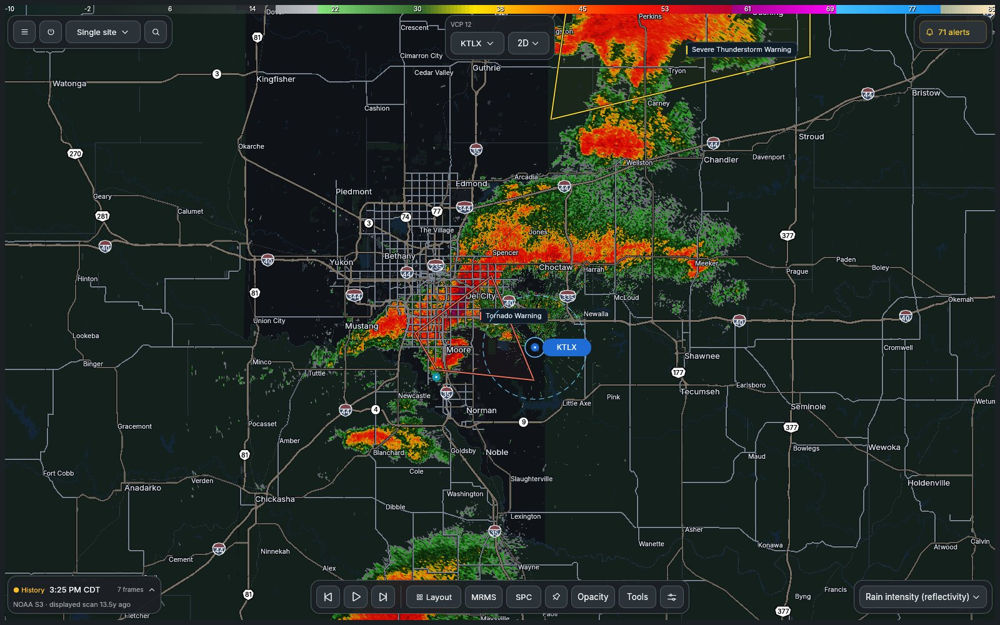
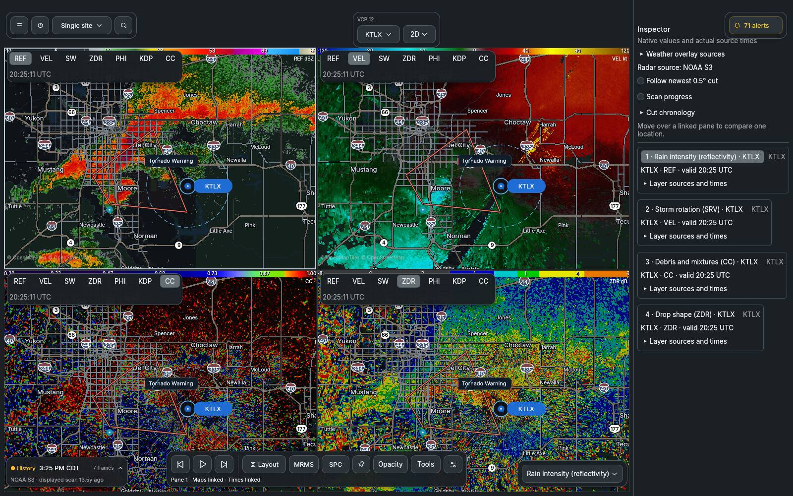
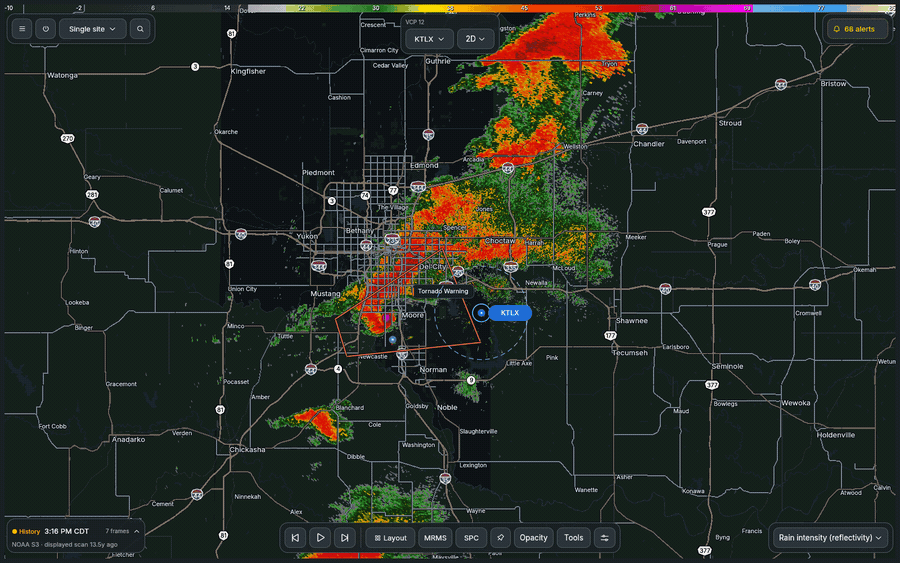

# Radar and Analyst interface

HookEcho opens in **Radar**: one map, one timeline, and a short menu. **Analyst** is an optional workbench for comparing products. The **Radar | Analyst** switch, search, and Settings stay in the fixed header, even when the menu is closed.

*Archive capture from KTLX on May 20, 2013; not current weather.*

## Find a control

| Section | Controls |
| --- | --- |
| **Radar** | Site and freshness; product, tilt, threshold, advanced product settings, Custom locations. |
| **Overlays** | Storm tracks, MRMS, storm attributes, SPC outlook. Day 1–3 and the risk legend stay together; click the selected day again to hide the outlook. |
| **Alerts** | Warning visibility and the alerts in view. The badge shows the count; incoming alerts do not open the section. |
| **Tools** | Searchable products and tools, plus saved workspaces. |

Click the gear for Settings in one step. **Ctrl+S** opens and focuses global search. **Space** plays or pauses radar; **Escape** hides or restores the map controls.

The Radar Zeta playback bar's **pin** button customizes up to four shortcuts. MRMS and SPC remain the defaults. Starred products appear first in the chooser; pinned products unavailable at the current radar remain saved for other sites. The same choices appear in minimal and full playback controls.

An armed map tool has a **Done** button on desktop and phones. Drawing controls include Pen, Eraser, Undo, Redo, Clear and Export; manual storm tracks expose direction, speed, horizon and cone controls in the same compact card. Escape closes the frontmost panel before canceling the tool, and Android Back cancels an armed tool before leaving the app.

Radar appearance offers individual resets for smoothing, precision, range-folded display, blend width, sector fading and the active product's pane palette. Opacity retains its **Reset · 100%** action. These resets leave other settings and other panes alone.

**Custom locations → Your places** shows current matching alerts from the loaded feed, nearby loaded radar age, and a forecast for each saved place. Forecasts load one place at a time while the window is open. **View radar here** opens the nearest radar over that place; **Forecast details** opens the existing detailed forecast. Missing or stale information is labeled explicitly; these cards do not infer an all-clear from an unavailable feed.

**Map → Offline readiness** brings saved map coverage and browser weather replay packs together. Download a small area before disconnecting, then use **Check saved area** to verify its files. A new map download replaces the previous saved area; interrupted replacements stay incomplete. Saved weather is dated replay, not live radar or new warnings. Browser storage can be cleared by the browser. Map downloads are limited to 3,000 tiles, 50 MB and four concurrent requests.

**Storm chasers** and map beacons can open a chaser's self-published YouTube link when their source record supplies one. An optional YouTube Data API key under **Settings → Integrations** enables broadcast-status checks. Unchecked, failed or expired checks say **unknown**; a recent position alone never means the video is live. Links do not independently verify someone's identity.

## Regional Clusters

At national and regional zooms (below zoom 7), blue regional chips replace repeated polygon labels. Each chip counts unique visible bulletins, rather than county polygon pieces. Click it to browse the region's warnings, watches, advisories, special weather statements and mesoscale discussions, then open the full bulletin. Shared county edges inside the same bulletin are suppressed at wide zoom. All enabled hazard footprints remain on the map; priority-dock thresholds do not filter them. Emergency labels stay prominent.

Zoom in for individual labels and tropical forecast timestamps. Radar sites remain selectable as small dots at wide zooms; the selected site's name stays visible. The existing layer controls, polygon inspection, tropical storm reader and single/compare views remain available.

Outline meshes are cached per pane and viewport. New feeds, camera changes, scale changes and display-density changes invalidate the cache. Offscreen rings are rejected before projecting their vertices; source polygons and hit testing retain their original detail.

## Build an analysis view

1. Click **Analyst**. On the first entry, the current radar map becomes pane 1.
2. Select a preset such as **Tornado**, or choose 1, 2, or 4 panes from the fixed analyst toolbar.
3. Click the pane to edit. Its label tells you which pane is active; radar product and overlay changes target it.
4. Enable **Maps** or **Time** to link pane positions or timeline selection. Open **Inspector** to view values and actual source times.
5. Click **Radar** to restore the previous single-map view. Click **Analyst** again to resume the analysis arrangement.

The app remembers each mode's site, camera, product, overlays, thresholds (including disabled thresholds), active pane, links, and selected live or archive time for the current session. It does not keep extra inactive renderers or downloads running. Save a workspace in Tools if you need the arrangement after restarting. Ordinary single-pane workspaces open in Radar; multi-pane and explicitly analyst workspaces open in Analyst. Older workspace files remain readable.

Workspaces and recovery retain each pane's storm-relative motion and raw/dealiased velocity choice. **Undo workspace action** also restores the forecast products, outlook filters and time-link settings replaced by an incoming scene link.

Choose **Compare raw / corrected velocity** from the product menu or search to open two linked NEXRAD panes, paused on the same archive scan. Each pane identifies its processing, and the product menu can change that pane to Raw, Corrected or App default. Correction uses the radar's measured Nyquist limit; missing or mixed limits leave correction unavailable rather than estimating a value from observed winds.

Displayed scan times follow the image actually painted on the map. A requested product missing from a partial scan is labeled unavailable; another measurement is never substituted under that product's label.

To send the arrangement to someone else, open **Share** or search for **Share live view** / **Share this exact time**. Both links include every visible pane, its products and layers, and camera/time links. Live opens with current data; exact-time opens paused at the displayed timestamps. The link uses the web app even when copied from desktop. Archives must still be available from their original source. Saved places, credentials, placefiles, custom palettes and user-defined radar products are not included; the Share page explains any unavailable choice.

On a phone, the mode switch remains available and sections open in a sheet. The menu header stays fixed while content scrolls, and the pane picker lets you move between analyst panes.

For the first scan and playback controls, start with the [user guide](GUIDE.md). The [website guide](https://hookecho.io/docs/radar-and-analyst/) covers the same workflow for browser users.
